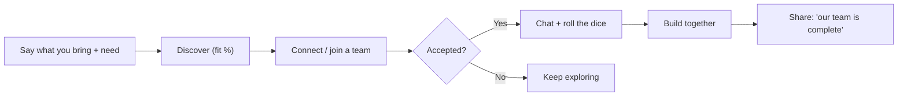
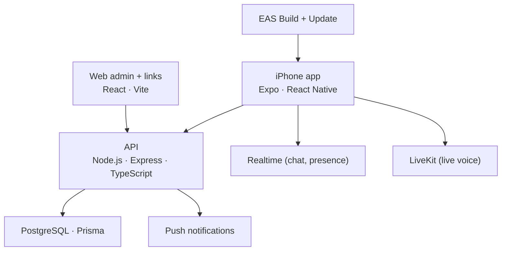

<p align="center">
  
</p>

# LOOP

**Find your build partner. Build something real.**

> iPhone app · Arabic-first · Saudi students and early builders · Product & systems case study

[](https://loopbuilders.app)
[](#status)
[](./docs/README.md)

---

## Overview

**LOOP** is an iPhone app that helps students and early builders in Saudi Arabia find the right people to build with, form hackathon teams, and actually start working together.

Most "find a teammate" attempts die in a group chat or a silent DM. LOOP turns that moment into a product: you say what you can do and what you need, LOOP suggests people who complete you, and the first step of building together is built in.

This repository is a **public showcase**. It documents product thinking, system design, and decisions — not the source code.

---

## Status

| | |
|---|---|
| **Platform** | iPhone (iOS). Android is planned after the iPhone launch |
| **Stage** | TestFlight beta (November 2026), App Store launch next |
| **Language** | Arabic-first (Saudi dialect), full English mode |
| **Website** | [loopbuilders.app](https://loopbuilders.app): links, legal pages, and the team's admin |

---

## Problem

- Community exists across many chats, but **finding the right person is luck**
- Hackathon recruiting is **noisy and capacity-blind**: "need a designer this weekend" gets lost
- Profiles are thin, so it's **hard to trust skills and commitment**
- A "match" usually **dies before any work starts**

The issue is rarely a lack of people. It's how discovery and teaming are productized.

---

## Solution

1. **Say what you bring and what you need**: roles, interests, goals, city
2. **Discover** people ranked by how well you complete each other, with a fit % and a one-line reason
3. **Connect** with an explicit request, or **join a hackathon team** for an open seat
4. **Start building**: the partner chat opens with a dice that rolls a real problem to build together
5. **Keep going**: teams get a group with live voice, posts and progress live in Communities

> *"The real problem wasn't finding developers — it was turning interest into teams that ship."*

---

## Key Features

| Feature | What it does |
|---------|--------------|
| **Discover** | One match card at a time, fit %, "why you fit", roles you offer vs. need |
| **Build partners** | Requests, a match moment, and a private chat with replies, voice notes and GIFs |
| **Challenge dice** | Roll a real problem with your partner, with starter files to begin |
| **Hackathon teams** | Events, team listings with open seats per role, join requests, team groups with **live voice** |
| **Communities** | Feed, "Looking for" posts, official and member communities, voice notes, whiteboard |
| **Share links that spread** | Every profile, team and hackathon has a link with a ready message ("1 seat left: we need a UI/UX designer") |
| **Profiles** | What you build, roles, interests, projects, GitHub, hackathon and partner counts, Early Builder badge |
| **Safety** | Automatic text and image filter, report and block everywhere, 24h review promise, account deletion |
| **Admin** | Users, reports, communities, support, and pilot metrics |

Details: [Feature Overview](./docs/feature-overview.md)

---

## Product Flow



**Pipeline:** `Intent → Match → Start → Build → Share`

More: [Discovery & Matching](./architecture/discovery-and-matching.md) · [Hackathon Team Lifecycle](./architecture/hackathon-team-lifecycle.md)

---

## System Architecture



| Layer | Technologies |
|-------|--------------|
| iPhone app | Expo, React Native, Expo Router, LiveKit, Sign in with Apple / Google / GitHub |
| Delivery | EAS Build → TestFlight · EAS Update for over-the-air fixes |
| API | Node.js, Express, TypeScript, Prisma |
| Data & realtime | PostgreSQL (Supabase), Supabase Realtime |
| Web | React, Vite, Tailwind (links, legal pages, staff admin) |
| Hosting | Railway (API) · Vercel (web) · Supabase (data) |

More: [System Architecture Overview](./architecture/system-architecture-overview.md)

---

## How Success Is Measured

LOOP doesn't count sign-ups as success. The admin tracks:

| Metric | Why |
|--------|-----|
| **Partnerships that started real work within 2 weeks** (north star) | A match only counts if both people actually build |
| Week-1 return | Do people find a reason to come back |
| Weekly active collaborations | Partnerships and teams working together this week |
| New members from shared links | Is growth coming from people sharing LOOP |
| Report response time | Is the community safe (24h promise) |

---

## Engineering Quality

- **2,600+ automated tests** across API, web and app
- CI gates: type checks, lint, **Arabic coverage** (every UI string must have Arabic), dependency audit, secret scan
- Arabic and right-to-left handled on purpose, including mixed Arabic/English share messages
- Privacy by design: matching runs on LOOP's own servers, shared-link analytics keep only the *kind* of link

---

## Screenshots

iPhone captures will be added under [`screenshots/`](./screenshots/) after the App Store launch.

---

## Why The Source Code Is Private

| Reason | Explanation |
|--------|-------------|
| **Product integrity** | Matching, safety and team flows are documented without exposing the implementation |
| **Security** | Keys, configuration and infrastructure details stay private |
| **Review focus** | Reviewers can evaluate the thinking without cloning a codebase |

Source access is available on request for authorized reviewers.

---

## Repository Structure

```text
Loop_showcase/
├── README.md
├── assets/
├── architecture/
│   ├── system-architecture-overview.md
│   ├── discovery-and-matching.md
│   └── hackathon-team-lifecycle.md
├── docs/
│   ├── README.md
│   ├── product-context.md
│   ├── feature-overview.md
│   ├── before-vs-with-loop.md
│   └── glossary.md
└── screenshots/
```

---

## Author

**Huda Mohammed AL Zahrani**
Founder of LOOP · Product Builder · TPM · Systems Thinker

- GitHub: [@hudaalzharani-commits](https://github.com/hudaalzharani-commits)
- LOOP: [loopbuilders.app](https://loopbuilders.app)

---

## License & Usage

This showcase documentation is provided for review purposes. The LOOP implementation and related intellectual property remain private unless agreed otherwise in writing.
