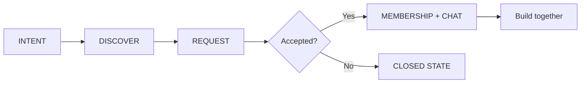
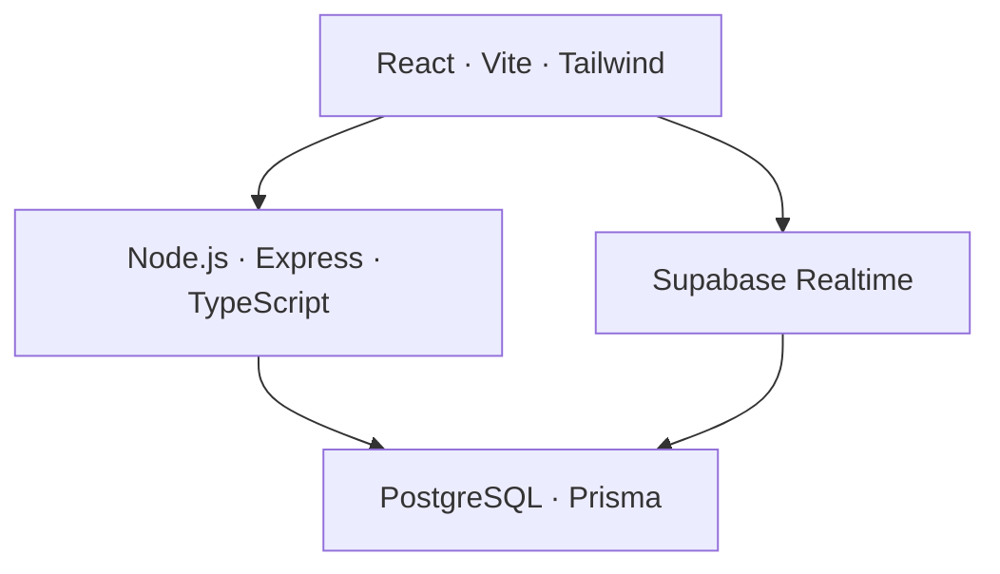

<p align="center">
  
</p>

# LOOP

**Developer Community Platform**

> Independent project · Learn · Build · Grow · Product & systems design case study

[](https://loop-hazel-sigma.vercel.app)
[](./docs/README.md)
[](https://hudaalzharani-commits.github.io/huda-portfolio/)

---

## Overview

**LOOP** is a mobile-first community platform for developers who want to **learn, build, and grow together**.

It helps people move from scattered Discord posts and silent DMs to **intent-based discovery**, **structured team recruiting**, and **collaboration that actually starts** — study rooms, build partners, hackathon teams, portfolios, and in-app chat.

This repository is a **public project showcase**. It documents product thinking, system architecture, and decision design — not proprietary source code.

---

## Problem

Developers often face the same underlying gap:

- Community exists across many chats, but **matching paths are unclear**
- Hackathon and project recruiting is **informal, noisy, and capacity-blind**
- Profiles are thin — hard to trust **skills, commitment, and intent**
- A “match” often dies before collaboration begins

The issue is rarely lack of people — it is **how discovery and teaming are productized**.

**Example scenario:**

> *“Need a frontend + backend teammate for a hackathon this weekend. Posted everywhere. Got nothing useful.”*

Without structure, interest stays as vague DMs — or silence.

---

## Solution

LOOP introduces a **community operating layer** between intent and action:

1. Declare what you are looking for (study, build, hackathon)
2. Discover people and teams filtered by that intent
3. Request to join with an explicit, confirmable flow
4. Accept / decline with capacity and recruiting state
5. Open partnership / team chat so matching becomes collaboration

> *“LOOP doesn’t invent community — it gives community a product shape.”*

---

## Key Features

| Feature | Description |
|---------|-------------|
| **Intent-based discovery** | Find peers by looking-for signal, skills, and goals |
| **Live Loop pulse** | Home signals that deep-link into rooms, projects, and teammate demand |
| **Study groups & rooms** | Shared presence for learning accountability |
| **Hackathon team cards** | Roles, size, availability, commitment, idea, recruiting ON/OFF |
| **Request lifecycle** | Pending → accepted / declined / cancelled / expired |
| **Builder identity** | Profile, portfolio, GitHub, active-team badge |
| **Support & admin** | Tickets, moderation shell, founder-direct in-app |

See [Feature Overview](./docs/feature-overview.md) for details.

---

## Product Flow



**Pipeline:** `Intent → Discover → Request → Collaborate`

Full documentation: [Discovery & Matching](./architecture/discovery-and-matching.md) · [Hackathon Team Lifecycle](./architecture/hackathon-team-lifecycle.md)

---

## System Architecture



| Layer | Technologies |
|-------|--------------|
| Frontend | React 19, Vite, Tailwind CSS, React Router |
| Backend | Node.js, Express, TypeScript, Prisma |
| Data | PostgreSQL (Supabase) |
| Realtime | Supabase Realtime |
| Deploy | Vercel (frontend) · Railway (API) · Supabase (DB) |

Full documentation: [System Architecture Overview](./architecture/system-architecture-overview.md)

---

## Screenshots

UI captures from the **LOOP** application — onboarding, home, discovery, teams, and ops.

> Add product captures under [`screenshots/`](./screenshots/). Until then, use the live demo.

### Live app

**[https://loop-hazel-sigma.vercel.app](https://loop-hazel-sigma.vercel.app)**

| Surface | What to look for |
|---------|------------------|
| Login / start | Brand-first entry |
| Home | Live Loop pulse + navigation into discovery / rooms |
| Discovery | Intent filters + view profile + request to join |
| Hackathon teams | Structured cards + recruiting state |
| Requests | Lifecycle management |
| Profile | Skills, looking-for, portfolio, active-team badge |
| Admin / support | Ops shell for a runnable community |

All captures live in [`screenshots/`](./screenshots/).

---

## Live Portfolio

The broader case-study portfolio is hosted on GitHub Pages:

**[https://hudaalzharani-commits.github.io/huda-portfolio/](https://hudaalzharani-commits.github.io/huda-portfolio/)**

Portfolio repository: [huda-portfolio](https://github.com/hudaalzharani-commits/huda-portfolio)

---

## Technologies Used

### Core — Backend
`Node.js` · `Express` · `TypeScript` · `Prisma`

### Core — Frontend
`React` · `Vite` · `Tailwind CSS` · `React Router`

### Data & Realtime
`PostgreSQL` · `Supabase` · Realtime presence

### Design & Architecture
Product mapping · UI flow design · request lifecycle design · mobile-first UX

### Dev & Validation
`VS Code` · `GitHub` · Vercel · Railway · scenario testing on live deploy

---

## Project Impact

Qualitative outcomes observed during design and validation:

| Outcome | Description |
|---------|-------------|
| **Clearer matching** | Intent + structured requests reduce vague DMs |
| **Fairer recruiting** | Capacity and ON/OFF recruiting prevent over-accept chaos |
| **Faster collaboration** | Accept path opens chat with shared context |
| **Runnable community** | Support, admin, and founder-direct keep ops sane |

> *“The real problem wasn’t finding developers — it was turning interest into teams that ship.”*

---

## Why The Source Code Is Private

This repository is intentionally a **showcase**, not a code dump.

| Reason | Explanation |
|--------|-------------|
| **Product integrity** | Domain flows (requests, capacity, ops) are documented without exposing full implementation |
| **Deployment privacy** | Secrets, env configs, and operational keys stay out of public docs |
| **Review focus** | Recruiters and interviewers can evaluate thinking without needing a full clone |
| **Professional context** | Matches the Call Helper / Gareeb showcase pattern used across the portfolio |

Architecture, flows, and product rationale are fully documented here. Source access is available on request for authorized reviewers.

---

## Repository Structure

```text
Loop_showcase/
├── README.md                          # Project showcase (this file)
├── assets/
│   ├── loop-project-banner.svg        # Repository banner
│   └── loop-logo.svg                  # Brand mark (vector)
├── architecture/
│   ├── system-architecture-overview.md
│   ├── discovery-and-matching.md
│   └── hackathon-team-lifecycle.md
├── docs/
│   ├── README.md
│   ├── product-context.md
│   ├── feature-overview.md
│   ├── before-vs-with-loop.md
│   └── glossary.md
└── screenshots/
    └── README.md
```

---

## Author

**Huda Mohammed AL Zahrani**  
Product Builder · TPM · Systems Thinker

- Portfolio: [hudaalzharani-commits.github.io/huda-portfolio](https://hudaalzharani-commits.github.io/huda-portfolio/)
- GitHub: [@hudaalzharani-commits](https://github.com/hudaalzharani-commits)
- Live LOOP: [loop-hazel-sigma.vercel.app](https://loop-hazel-sigma.vercel.app)

---

## License & Usage

This showcase documentation is provided for portfolio and review purposes. System implementation and associated intellectual property remain private unless otherwise agreed in writing.
