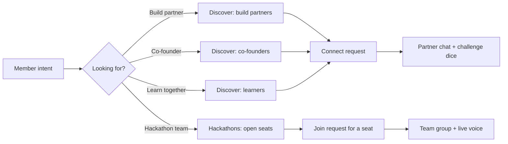

# Discovery & Matching

How LOOP moves people from **intent → match → first shared work**.

## Intent Model

Members declare what they can contribute, what they need, their interests and city, and what they're looking for. Discover filters and ranks by that.

## Ranking: "complete each other"

Each candidate gets a fit percentage from signals such as:

| Signal | Example |
|--------|---------|
| Complementary roles | They offer backend, you need backend |
| Shared intent | Both looking for a hackathon team |
| Shared interests | React, AI, UI/UX |
| Place and activity | Same city, recently active |

The card explains the strongest reason in one line ("Sara brings backend, you bring frontend"). People who already declined, are already partners, or have a pending request are left out. Ranking runs on LOOP's own servers.

## Matching Principles

1. **Signal clarity**: profiles show what someone builds, offers and needs
2. **Explicit asks**: Connect and join requests need confirmation, so there's no silent spam
3. **Lifecycle honesty**: pending, accepted and declined states are visible to both sides
4. **Capacity respect**: full teams stop showing as recruiting, so no one requests a seat that doesn't exist
5. **Start, don't just match**: an accepted partnership opens a chat with a first problem to build

## Profile as a decision surface

- What they're building, roles offered and needed, interests
- Hackathons joined, build partners, projects, GitHub
- A join action only while their team is recruiting
- Share link with a personal-tip message

## Related Documents

- [Hackathon Team Lifecycle](./hackathon-team-lifecycle.md)
- [Feature Overview](../docs/feature-overview.md)
- [Before vs With LOOP](../docs/before-vs-with-loop.md)
