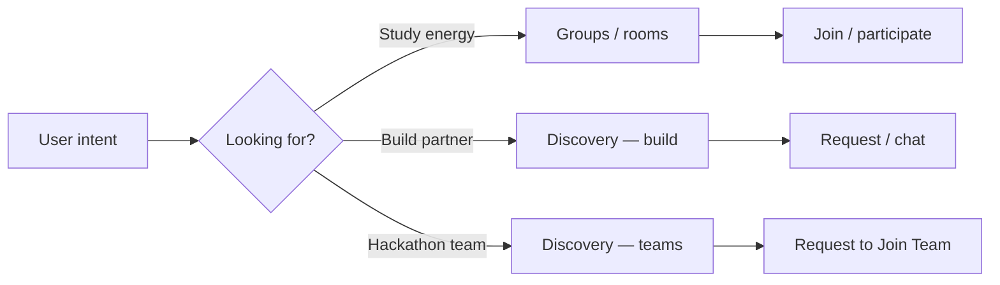

# Discovery & Matching

Conceptual design of how LOOP moves users from **intent → visibility → request → collaboration**.

## Intent Model

Users declare what they are looking for. Discovery and home deep-links respect that intent.

## Live Loop Signals

Home does not only display vanity metrics — each pulse is a **navigation cue**:

| Signal | Destines users to |
|--------|-------------------|
| Learners online | Discovery |
| Studying now / active rooms | Groups |
| Projects today | Discovery (build partners) |
| Need teammates | Discovery (hackathon teams) |

## Matching Principles

1. **Signal clarity** — profiles show skills, looking-for, portfolio, and active-team context
2. **Explicit asks** — join requests require confirmation; no silent spam
3. **Lifecycle honesty** — pending / accepted / declined states are visible to both sides
4. **Capacity respect** — teams stop accepting when full or recruiting is off
5. **Collaboration handoff** — acceptance opens the conversation that makes the match useful

## View Profile

Profile is a decision surface, not a vanity page:

- About + skills + looking-for
- Portfolio / GitHub credibility
- Join actions when the profile owner is recruiting
- Active hackathon team badge when relevant

## Related Documents

- [Hackathon Team Lifecycle](./hackathon-team-lifecycle.md)
- [Feature Overview](../docs/feature-overview.md)
- [Before vs With LOOP](../docs/before-vs-with-loop.md)
