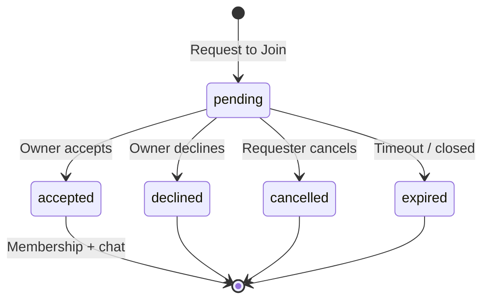

# Hackathon Team Lifecycle

How LOOP treats hackathon recruiting as a **product workflow**, not a free-text post.

## Structured Team Card

A recruiting post captures operational fields up front:

| Field | Why it matters |
|-------|----------------|
| Hackathon | Shared event context |
| Roles needed | Skill fit |
| Team size | Capacity planning |
| Availability / commitment | Realistic collaboration |
| Project idea | Alignment before join |
| Recruiting ON / OFF | Explicit open / closed state |

## Request Lifecycle

## Accept Path (Conceptual)

When an owner accepts a pending request:

1. **Membership** is created for the requester
2. **Capacity** is re-checked; further accepts may close recruiting
3. **Partnership / team chat** context opens
4. **Notifications** inform both sides
5. **Profile badge** can reflect Active Hackathon Team status

## Decline / Cancel / Expire

These states are first-class — so discovery does not leave people waiting forever without signal.

## Requests Hub

Users manage hackathon requests from a dedicated requests experience (reachable from chat / notifications), with detail views for accept / decline actions.

## Design Rationale

| Without structure | With LOOP lifecycle |
|-------------------|---------------------|
| “DM me if interested” | Explicit request object |
| Unclear team size | Capacity-aware accepts |
| Ghosted interest | Visible status |
| Match without workspace | Chat after accept |

## Related Documents

- [Discovery & Matching](./discovery-and-matching.md)
- [System Architecture Overview](./system-architecture-overview.md)
- [Feature Overview](../docs/feature-overview.md)
