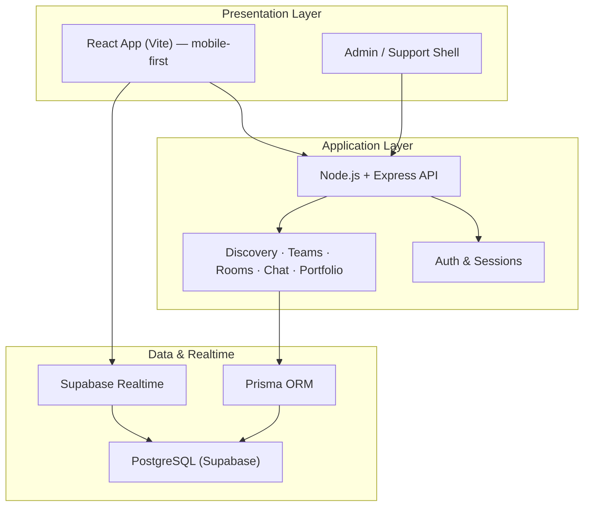

# System Architecture Overview

High-level architecture of the LOOP community platform. This document describes **design layers and responsibilities** — not proprietary implementation details.

## Layered Architecture

## Component Responsibilities

| Layer | Components | Role |
|-------|------------|------|
| **Presentation** | React 19, Vite, Tailwind, React Router | Discovery, rooms, requests, chat, profile, admin UI |
| **Application** | Node.js, Express, TypeScript | Auth, domain APIs, notifications, GitHub OAuth hooks |
| **Data** | PostgreSQL, Prisma | Users, teams, requests, memberships, tickets |
| **Realtime** | Supabase Realtime | Presence and live collaboration signals |
| **Deploy** | Vercel · Railway · Supabase | Frontend / API / database split |

## Design Characteristics

- **Monorepo, split deploy** — `frontend/` and `backend/` ship independently
- **Intent-shaped APIs** — discovery and team flows encode product intent, not generic CRUD
- **Request as first-class object** — join asks have status, capacity, and side effects (membership, chat)
- **Ops shell** — admin / support / founder-direct separated from learner UX
- **Builder identity** — portfolio and GitHub integration reinforce trust in matching

## Related Documents

- [Discovery & Matching](./discovery-and-matching.md)
- [Hackathon Team Lifecycle](./hackathon-team-lifecycle.md)
- [Feature Overview](../docs/feature-overview.md)

## Design Tools

Flows and surfaces were shaped with product mapping, UI prototyping, and iterative live validation on the deployed stack.
