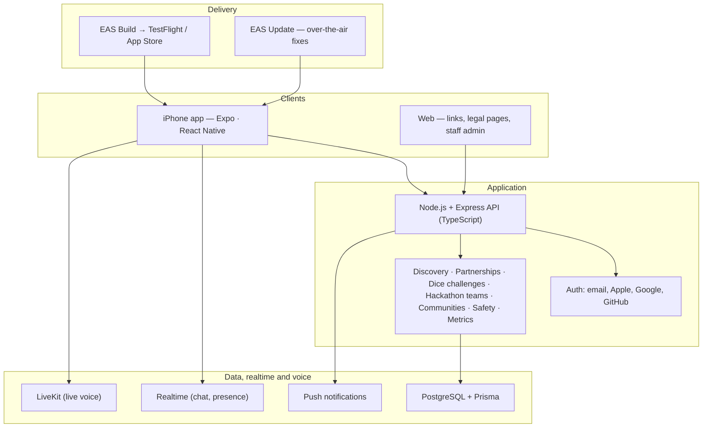

# System Architecture Overview

High-level architecture of LOOP. This document describes **layers and responsibilities**, not proprietary implementation details.

## Layered Architecture

## Component Responsibilities

| Layer | Components | Role |
|-------|------------|------|
| **iPhone app** | Expo, React Native, Expo Router | All member features, Arabic/English, right-to-left layout |
| **Web** | React, Vite, Tailwind | Universal-link landing, legal pages, staff admin and metrics |
| **API** | Node.js, Express, TypeScript, Prisma | Auth, matching, teams, safety, notifications, analytics |
| **Data** | PostgreSQL (Supabase) | Members, profiles, partnerships, teams, posts, reports |
| **Realtime & voice** | Supabase Realtime, LiveKit | Live chat updates, presence, team voice |
| **Hosting** | Railway · Vercel · Supabase | API / web / data split |

## Design Characteristics

- **iPhone first** — the app is where members live; the web is for links and the team
- **Over-the-air delivery** — screen and text fixes ship in minutes without a store build; native changes bump the app version so old builds never receive incompatible code
- **Intent-shaped APIs** — discovery and team flows encode product intent, not generic CRUD
- **Requests as first-class objects** — join and partner requests have status, capacity, and side effects (membership, chat)
- **Safety in the write path** — text and images are filtered before they are posted; report and block exist on every surface
- **Arabic as a requirement** — CI fails if any UI string has no Arabic; share messages are built to read correctly when Arabic and English mix
- **Privacy by design** — matching runs on LOOP's own servers; growth analytics keep only the kind of shared link, never who shared it

## Related Documents

- [Discovery & Matching](./discovery-and-matching.md)
- [Hackathon Team Lifecycle](./hackathon-team-lifecycle.md)
- [Feature Overview](../docs/feature-overview.md)
